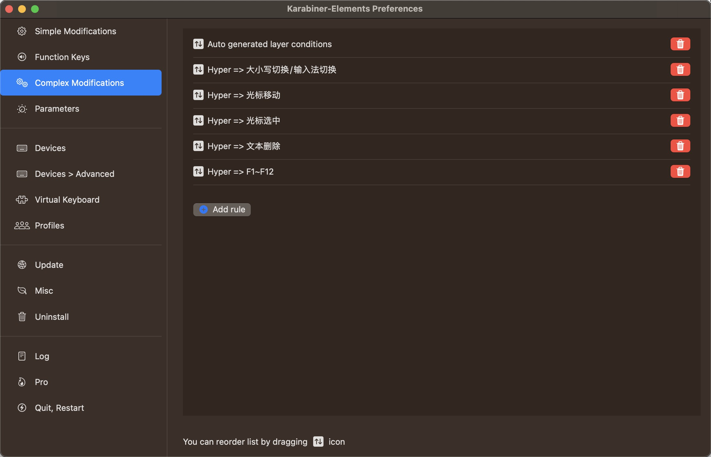
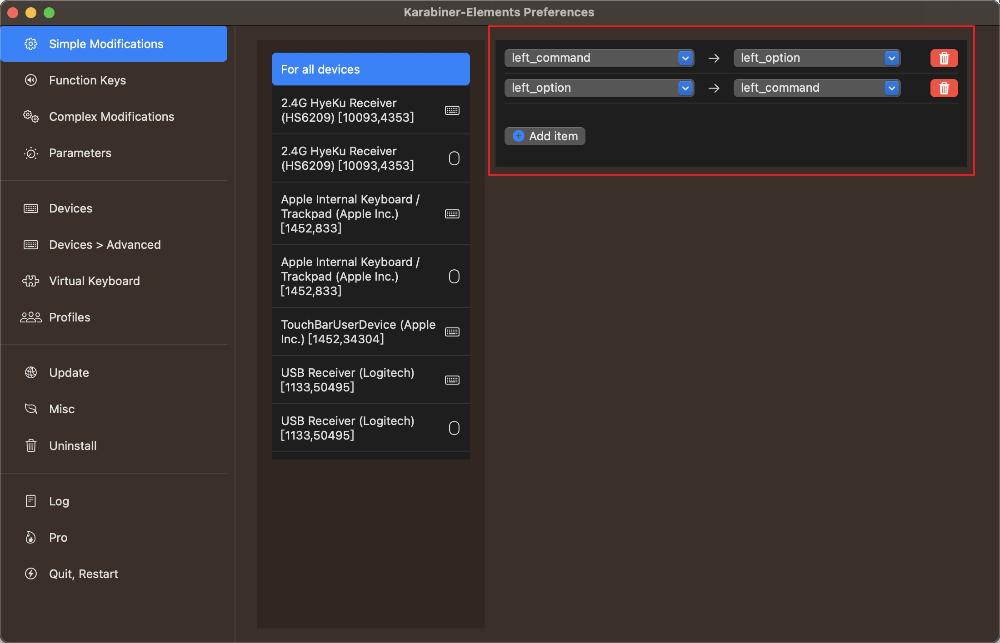

# capslox-karabiner

本项目是基于karabiner实现替代[capslox软件](https://capslox.com)
部分功能的配置，由于在内测阶段一直使用capslox，且仅使用了基础热键，故没有参与付费购买，当然capslox不得不说是一款在Mac上非常好用的软件。

当前规则版本为 **1.1.0**，已按 Karabiner-Elements **16.1.0** 的配置规范完成校验。Karabiner-Elements 16.1.0 支持 macOS 13 及更高版本。

## 安装

1. 下载并安装 [Karabiner-Elements](https://karabiner-elements.pqrs.org/)
2. 打开 Karabiner-Elements 的 `Setup` 页面，按照提示授予后台活动、输入监控和辅助功能权限。Karabiner-Elements 16.x 的 `Karabiner-Core-Service` 需要辅助功能权限
3. 在默认浏览器中输入下面网址，并回车
    ```shell
    karabiner://karabiner/assets/complex_modifications/import?url=https://raw.githubusercontent.com/yqchilde/capslox-karabiner/main/capslox-karabiner.json
    ```
4. 跳转至 Karabiner-Elements 并确认导入
5. 进入 `Complex Modifications`，点击 `Add predefined rule`，分别启用本项目的 5 组规则



**注意：**

如果外接的是 Windows 键位布局键盘，并且 Command/Option 的物理位置不符合使用习惯，可以按下图交换键位；标准 Mac 键盘通常不需要调整：



## 认识键盘符号

README下文将用以下符号来表示按键位及映射键位，其代表释义如下：

| 符号 | Name     | 符号    | Name      |
| ---- | -------- | ------- | --------- |
| `⇪`  | Capslock | `↖`     | Home      |
| `⎋`  | Escape   | `↘`     | End       |
| `⌘`  | Command  | `⇞`     | Page Up   |
| `⌥`  | Option   | `⇟`     | Page Down |
| `⌃`  | Control  | `🖱️` `L` | 鼠标左击  |
| `⇧`  | Shift    | `🖱️` `R` | 鼠标右击  |
| `⌫`  | Delete   | `🖱️` `F` | 鼠标前进  |
|      |          | `🖱️` `B` | 鼠标后退  |

## 用法

### Capslock赋能成Hyper

将Capslock赋能为一个全新的功能修饰键 **✱ Hyper** ，类似于同时按下 `⇧` `⌃` `⌥` `⌘`

| 按键             | 映射为         | 说明                  |
|----------------|-------------| --------------------- |
| `⇪` 单击         | `escape`    | 单击Capslock发送ESC   |
| `⇪` 长按         | `hyper`     | 按住Capslock启用Hyper |
| `⇪` + `escape` | `caps_lock` | 单击ESC切换大写锁定   |
| `⇪` `spacebar` | `ctrl` + `spacebar` | 单击空格切换输入法    |

### Hyper => 光标移动

长按 **Capslock (✱ Hyper) 键** 配合进行操作

| 按键    | 映射为                                      | 说明       |
| ------- |------------------------------------------|----------|
| `⇪` `E` | `↑`                                      | 向上移动     |
| `⇪` `D`     | `↓`                                      | 向下移动     |
| `⇪` `S`     | `←`                                      | 向左移动     |
| `⇪` `F`     | `→`                                      | 向右移动     |
| `⇪` `A`     | `option` + `←`                           | 向左移动一个单词 |
| `⇪` `G`     | `option` + `→`                           | 向右移动一个单词 |
| `⇪` `P`     | `command` + `←` 或 `ctrl` + `A`           | 移动至行首    |
| `⇪` `;`     | `command` + `→` 或 `ctrl` + `E`           | 移动至行尾   |
| `⇪` `⌘` `P` | `command` + `home` 或 `command` + `↑` | 移动至页首  |
| `⇪` `⌘` `;` | `command` + `end` 或 `command` + `↓` | 移动至页尾    |

在 Terminal.app、iTerm2、JetBrains IDE 和 CLI-Manager 中，行首/行尾分别发送 `control + A`、`control + E`，以适配终端内的 zsh/readline 快捷键。

### Hyper => 光标选中

| 按键 | 映射为                                                 | 说明       |
| ---- |-----------------------------------------------------|----------|
| `⇪` `I`  | `shift` + `↑`                                       | 向上选中     |
| `⇪` `K`  | `shift` + `↓`                                       | 向下选中     |
| `⇪` `J`  | `shift` + `←`                                       | 向左选中     |
| `⇪` `L`  | `shift` + `→`                                       | 向右选中     |
| `⇪` `H`  | `shift` + `option` + `←`                            | 向左选中一个单词 |
| `⇪` `N`  | `shift` + `option` + `→`                            | 向右选中一个单词 |
| `⇪` `Y`     | `option` + `↑`                                      | 向外括选区域   |
| `⇪` `B`     | `option` + `下`                                      | 向内缩减区域   |
| `⇪` `U`  | `shift` + `command` + `←`                           | 选中至行首    |
| `⇪` `O`  | `shift` + `command` + `→`                           | 选中至行尾    |
| `⇪` `⌘` `U` | `shift` + `command` + `home` 或 `shift` + `command` + `↑` | 选中至页首    |
| `⇪` `⌘` `O` | `shift` + `command` + `end` 或 `shift` + `command` + `↓` | 选中至页尾    |
| `⇪` `,` | `option` + `←` && `shift` + `option` + `→`          | 选中当前单词   |
| `⇪` `⌘` `,` | `command` + `←` && `shift` + `command` + `→`        | 选中当前行 |
| `⇪` `⌘` `I` | `shift` + `option` + `↑`                            | 选中的行向上移动 |
| `⇪` `⌘` `K` | `shift` + `option` + `↓`                            | 选中的行向下移动 |
| `⇪` `⌥` `R` | `shift` + `F6`                                      | 重命名选中变量名/函数名 |

VS Code 中的重命名映射依赖 [JetBrains Keymap](https://marketplace.visualstudio.com/items?itemName=isudox.vscode-jetbrains-keybindings) 扩展；JetBrains IDE 可直接使用。

### Hyper => 文本删除

| 按键          | 映射为                                     | 说明     |
|-------------|-----------------------------------------| -------- |
| `⇪` `W`     | `delete_or_backspace`                   | 向左删除 |
| `⇪` `R`     | `delete_forward`                        | 向右删除 |
| `⇪` `⌘` `W` | `option` + `delete_or_backspace`        | 向左删除一个单词 |
| `⇪` `⌘` `R` | `option` + `delete_forward`             | 向右删除一个单词 |
| `⇪` `[`     | `shift` + `home` && `delete_or_backspace` | 删除至行首 |
| `⇪` `/`     | `shift` + `end` && `delete_or_backspace` | 删除至行尾 |
| `⇪` `⌫`     | `command` + `delete_or_backspace`       | 删除当前行 |
| `⇪` `⌘` `⌫` | `command` + `A` && `delete_or_backspace` | 删除全部内容 |

### Hyper => F1~F12

| 按键      | 映射为   | 说明    |
|---------|-------|-------|
| `⇪` `1` | `f1`  | f1按键  |
| `⇪` `2` | `f2`  | f2按键  |
| `⇪` `3` | `f3`  | f3按键  |
| `⇪` `4` | `f4`  | f4按键  |
| `⇪` `5` | `f5`  | f5按键  |
| `⇪` `6` | `f6`  | f6按键  |
| `⇪` `7` | `f7`  | f7按键  |
| `⇪` `8` | `f8`  | f8按键  |
| `⇪` `9` | `f9`  | f9按键  |
| `⇪` `0` | `f10` | f10按键 |
| `⇪` `-` | `f11` | f11按键 |
| `⇪` `=` | `f12` | f12按键 |

## 开发与校验

`capslox-karabiner.edn` 是规则源码，`capslox-karabiner.json` 是供用户导入的发布文件。开发环境需要：

- [GokuRakuJoudo](https://github.com/yqrashawn/GokuRakuJoudo) 0.8.x
- `jq`
- Karabiner-Elements 自带的 `karabiner_cli`（用于官方规则校验）

修改 EDN 后重新生成发布 JSON：

```shell
make build
```

检查 EDN/JSON 是否同步，并使用官方 CLI 校验：

```shell
make check
```

建议发布前通过 Karabiner-EventViewer 验证 Caps Lock 单击、Hyper 组合键、页首/页尾、输入法切换和 F1–F12。

## 参考项目

- [https://github.com/BryanHoo/Capslock-Plus](https://github.com/BryanHoo/Capslock-Plus)
- [https://github.com/Vonng/Capslock](https://github.com/Vonng/Capslock)
